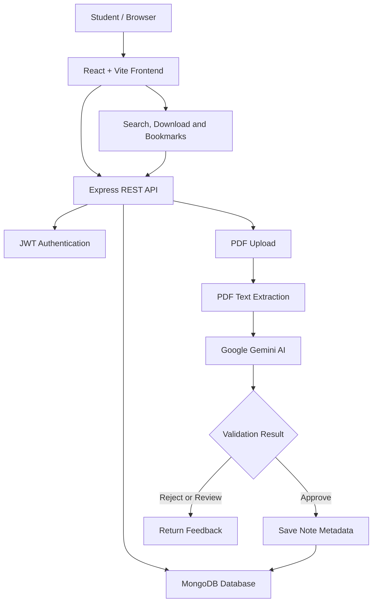

# StudyShelf — Student Notes Sharing Platform

A full-stack web application that helps students upload, discover, download, and bookmark study notes. StudyShelf also integrates **Google Gemini AI** to evaluate uploaded PDF notes for educational relevance and subject matching before they are published.

**Live Demo:** [Open StudyShelf](https://student-notes-platform-five.vercel.app/)  
**Backend API:** [View Backend](https://student-notes-platform-6h05.onrender.com)  
**Source Code:** [GitHub Repository](https://github.com/ayushb0020/Student_Notes_Platform)

## Features

### User Authentication
- User registration and login.
- Password hashing with bcrypt.
- JWT-based authentication for protected operations.

### Notes Management
- Upload study notes in PDF format with a title, subject, and description.
- Browse and search notes by title, subject, and description.
- Download available PDF notes.
- Bookmark and unbookmark notes.
- View and delete your own uploaded notes.

### Gemini AI PDF Validation
- Extracts readable text from uploaded PDFs.
- Uses the Google Gemini API to evaluate whether the document contains meaningful educational content.
- Checks whether the content is relevant to the selected subject.
- Classifies uploads into three outcomes:
  - **Approve:** The PDF appears relevant and educational.
  - **Reject:** The PDF appears unrelated, spam, or unsuitable.
  - **Review:** The content is insufficient or ambiguous.
- Provides a reason for the validation result.
- Prevents PDFs that are rejected or require review from being published through the normal upload flow.

> **Important:** AI validation is an automated screening step, not a guarantee of correctness. It may make mistakes, so the result should not be treated as a substitute for human review.

### User Interface
- Responsive React interface.
- Search, upload, bookmarking, and note-management workflows.
- User-friendly feedback for upload and validation outcomes.

## Tech Stack

| Component | Technology |
|---|---|
| Frontend | React, Vite, CSS |
| Backend | Node.js, Express.js |
| Database | MongoDB, Mongoose |
| Authentication | JWT, bcryptjs |
| File uploads | Multer |
| PDF text extraction | pdf-parse |
| AI integration | Google Gemini API, `@google/genai` |
| Frontend deployment | Vercel |
| Backend deployment | Render |

## Architecture



### How AI Validation Works

1. A logged-in user submits a PDF with its title, subject, and optional description.
2. The backend extracts readable text from the PDF.
3. The extracted text and note metadata are sent to the Gemini API for evaluation.
4. Gemini returns a classification and a short explanation.
5. The backend checks the classification and only saves the note if it is approved.
6. Rejected or review-required uploads receive feedback instead of being published.

The AI API key is stored in the backend environment, not in the frontend.

## Project Structure

```text
Student_Notes_Platform/
├── client/
│   └── src/
│       └── App.jsx
├── server/
│   └── src/
│       ├── models/
│       │   └── Note.js
│       ├── routes/
│       │   └── notes.js
│       ├── utils/
│       │   ├── extractPdfText.js
│       │   └── validateNoteWithGemini.js
│       └── server.js
├── .gitignore
└── README.md
```

*The structure above highlights the main files; additional application files and configuration files are omitted for readability.*

## Getting Started

### Prerequisites

Install the following:

- Node.js and npm.
- A MongoDB database, either local or through MongoDB Atlas.
- A Google Gemini API key from [Google AI Studio](https://aistudio.google.com/api-keys).

### 1. Clone the repository

```bash
git clone https://github.com/ayushb0020/Student_Notes_Platform.git
cd Student_Notes_Platform
```

### 2. Configure the backend

```bash
cd server
npm install
```

Create a `.env` file inside the `server` directory using the following variables:

```env
PORT=5000
MONGODB_URI=your_mongodb_connection_string
JWT_SECRET=your_long_random_secret
CLIENT_URL=http://localhost:5173
GEMINI_API_KEY=your_gemini_api_key
```

Replace the example values with your own credentials. Keep the `.env` file private and never commit it to GitHub.

Make sure your Gemini API key and selected model are available to your Google AI Studio project under its current API access and usage limits.

Start the backend using the script configured in `server/package.json`:

```bash
npm run dev
```

The local API should run at `http://localhost:5000` if the port is available.

### 3. Configure the frontend

Open a second terminal from the project root:

```bash
cd client
npm install
npm run dev
```

Open the local URL printed by Vite, usually `http://localhost:5173`.

If your frontend uses an environment variable for the backend URL, configure it according to the variable name expected by your client code. For local development, point it to `http://localhost:5000`.

### 4. Verify the application

Test the following workflows:

- Register and log in.
- Upload a relevant PDF and check the validation result.
- Upload a PDF whose content does not match the selected subject.
- Confirm that rejected or review-required PDFs are not published.
- Search for notes, download an available PDF, and bookmark a note.
- Confirm that a user can manage their own uploads.

## Environment Variables

| Variable | Purpose |
|---|---|
| `PORT` | Backend server port |
| `MONGODB_URI` | MongoDB connection string |
| `JWT_SECRET` | Secret used for JWT authentication |
| `CLIENT_URL` | Allowed frontend origin for cross-origin requests |
| `GEMINI_API_KEY` | Backend-only key used to access the Gemini API |

Never expose `GEMINI_API_KEY` in frontend code, browser requests, screenshots, or public repositories. If a key is accidentally exposed, revoke it and create a replacement.

## Deployment

- **Frontend:** [Vercel deployment](https://student-notes-platform-five.vercel.app/)
- **Backend:** [Render deployment](https://student-notes-platform-6h05.onrender.com)
- **Database:** MongoDB Atlas or another configured MongoDB instance.

Configure production environment variables in the respective hosting dashboards. The deployed frontend must point to the deployed backend, and the backend must allow the production frontend origin.

**File storage note:** If PDFs are stored on the backend's local filesystem, they may not persist across service restarts or redeployments on hosting platforms with ephemeral storage. Persistent object storage is recommended for a production deployment.

Free hosting services may also pause after inactivity, so the first request can take longer while a service starts.

## Current Limitations

- AI-generated validation decisions can be incorrect.
- PDFs with scanned pages or very little extractable text may require review.
- Gemini API availability, rate limits, model access, and free-tier quotas can affect validation.
- Local filesystem uploads are not a substitute for durable production file storage.
- Additional production hardening, such as rate limiting, account recovery, and stronger file-upload controls, may be needed before wider public use.

## Future Improvements

- Store uploaded PDFs in persistent cloud object storage.
- Add administrator review and moderation tools.
- Improve scanned-PDF support with OCR.
- Add automated tests for authentication, uploads, and AI validation.
- Add note ratings, comments, and recommendations.

## Learning Outcomes

This project demonstrates practical experience with:

- Full-stack web development using React and Node.js.
- REST API development and MongoDB data modeling.
- Authentication and protected routes.
- PDF file handling and text extraction.
- Integrating a generative AI API into a backend workflow.
- Environment configuration and deployment.

---

**Built as a learning project to make sharing study materials easier and explore practical AI integration in a full-stack application.**
